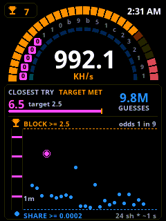

# NerdMiner CYD Modded

[](https://github.com/guitarbeat/nerdminer-cyd-modded/releases/latest)
[](https://guitarbeat.github.io/nerdminer-cyd-modded/)
[](https://github.com/guitarbeat/nerdminer-cyd-modded)
[](https://github.com/HenrysCat/NerdMiner-Modded)
[](LICENSE)

An optimized, all-in-one ESP32 Bitcoin solo-mining project combining **high-performance firmware optimizations (~860–1000 KH/s)** with full hardware support for **Cheap Yellow Display (CYD)** boards, **live settings without rebooting**, **backup pool failover/failback**, a **virtual on-device CYD web twin**, and an **instant browser-based 1-click Web Flasher**.

---

## ⚡ 1-Click Web Flasher (No Coding Required)

Flash your board directly from Google Chrome, Edge, or any Web-Serial-compatible browser:

👉 **[Launch NerdMiner CYD Web Flasher](https://guitarbeat.github.io/nerdminer-cyd-modded/)**

1. Connect your ESP32 / CYD to your computer via a data-capable USB cable.
2. Open the [Web Flasher](https://guitarbeat.github.io/nerdminer-cyd-modded/).
3. Select your hardware variant from the list.
4. Click **Connect**, choose your serial port, and follow the on-screen instructions to flash.

---

## 📦 Pre-compiled Binaries ([Release v2.0.0](https://github.com/guitarbeat/nerdminer-cyd-modded/releases/tag/v2.0.0))

> Merged upstream [HenrysCat/NerdMiner-Modded V1.5.1](https://github.com/HenrysCat/NerdMiner-Modded): M5StickC Plus2 support, T-Display 1.14" Pulse theme, stratum object-error / duplicate-share fixes, CYD RGB LED Off-at-boot fix, dual-slot power-cut-proof mining stats.

Prefer flashing offline with `esptool.py`, ESP Flash Download Tools, or via local OTA? Pre-built binaries are available for direct download:

| Hardware Target | Full Factory Install (`0x00000`) | Firmware Update (`0x10000` / OTA) |
| :--- | :--- | :--- |
| **2.8" CYD (GPIO 27 Backlight)** | [`ESP32-2432S028R-BL27_factory.bin`](https://github.com/guitarbeat/nerdminer-cyd-modded/releases/download/v2.0.0/ESP32-2432S028R-BL27_factory.bin) | [`ESP32-2432S028R-BL27_firmware.bin`](https://github.com/guitarbeat/nerdminer-cyd-modded/releases/download/v2.0.0/ESP32-2432S028R-BL27_firmware.bin) |
| **2.8" CYD (Standard GPIO 21)** | [`ESP32-2432S028R_factory.bin`](https://github.com/guitarbeat/nerdminer-cyd-modded/releases/download/v2.0.0/ESP32-2432S028R_factory.bin) | [`ESP32-2432S028R_firmware.bin`](https://github.com/guitarbeat/nerdminer-cyd-modded/releases/download/v2.0.0/ESP32-2432S028R_firmware.bin) |
| **2.4" CYD (Single USB-C)** | [`ESP32-2432S024R_factory.bin`](https://github.com/guitarbeat/nerdminer-cyd-modded/releases/download/v2.0.0/ESP32-2432S024R_factory.bin) | [`ESP32-2432S024R_firmware.bin`](https://github.com/guitarbeat/nerdminer-cyd-modded/releases/download/v2.0.0/ESP32-2432S024R_firmware.bin) |
| **2.8" CYD (Dual USB)** | [`ESP32-2432S028-2USB_factory.bin`](https://github.com/guitarbeat/nerdminer-cyd-modded/releases/download/v2.0.0/ESP32-2432S028-2USB_factory.bin) | [`ESP32-2432S028-2USB_firmware.bin`](https://github.com/guitarbeat/nerdminer-cyd-modded/releases/download/v2.0.0/ESP32-2432S028-2USB_firmware.bin) |

#### Cryptographic Verification
Verify the SHA-256 hashes against the canonical manifest:
```bash
curl -sLO https://github.com/guitarbeat/nerdminer-cyd-modded/releases/download/v2.0.0/SHA256SUMS
sha256sum -c SHA256SUMS
```

#### Flashing via esptool.py
```bash
# Full Factory Flash (erases settings):
esptool.py --chip esp32 --port /dev/ttyUSB0 --baud 921600 write_flash 0x0 ESP32-2432S028R-BL27_factory.bin

# Firmware Update Only (preserves settings):
esptool.py --chip esp32 --port /dev/ttyUSB0 --baud 921600 write_flash 0x10000 ESP32-2432S028R-BL27_firmware.bin
```

---

## 🖥️ Supported Hardware Variants

This repository provides dedicated environments for popular Cheap Yellow Display (CYD) revisions and ESP32 solo miners:

| Board / Target | Display | PlatformIO Env | Description & Specifics |
|---|---|---|---|
| **ESP32-2432S028R (BL27)** | 2.8" TFT (240x320) | `ESP32-2432S028R-BL27` | 2.8" CYD variant with **Backlight on GPIO 27** (fixes black screen on BL27 revisions) |
| **ESP32-2432S028R** | 2.8" TFT (240x320) | `ESP32-2432S028R` | Single Micro-USB port, Backlight GPIO 21 |
| **ESP32-2432S024R** | 2.4" TFT (240x320) | `ESP32-2432S024` | Single USB-C port, Backlight GPIO 27, RGB LED pins 16/17 swapped |
| **ESP32-2432S028R-2USB** | 2.8" TFT (240x320) | `ESP32_2432S028_2USB` | Dual USB (USB-C + Micro-USB) |
| **LILYGO TTGO T-Display** | 1.14" IPS LCD | `TTGO-T-Display` | ST7789 display controller |
| **ESP32-C3 SuperMini** | None / External OLED | `ESP32-C3` | Compact RISC-V solo miner |
| **Wemos S2 / C2 Mini** | None / External | `ESP32-S2` / `ESP32-C2` | Low-cost ESP32 variants |
| **M5Stack M5Stick-C** | 0.96" TFT | `M5Stick-C` | Portable M5Stack wearable form factor |
| **ESP32 DevKit V1** | None / External | `ESP32-DevKit` | Standard 30/38 pin ESP32 developer boards |

---

## ⚙️ Initial Configuration (WiFi & Wallet)

Once flashed and powered on:

1. **Connect to WiFi AP**: On your phone or computer, connect to the WiFi network:
   - **SSID**: `NerdMinerAP`
   - **Password**: `MineYourCoins`
2. **Access Portal**: If the captive portal doesn't open automatically, open your browser and navigate to `http://192.168.4.1`.
3. **Configure Settings**:
   - Select your local WiFi SSID and enter your WiFi password.
   - Enter your **Bitcoin Wallet Address** (e.g., SegWit `bc1...` or legacy `1...`).
   - *(Optional)* Add a worker identifier: `YourAddress.workername`.
   - Select pool settings (defaults to [Public-Pool.io](https://public-pool.io/)).
   - Configure optional backup pool for automatic failover.
4. **Save and Start Mining**: The miner connects to your Wi-Fi and begins solo mining immediately!

To view your miner stats online, visit [web.public-pool.io](https://web.public-pool.io/) and enter your BTC payout address.

### 💾 MicroSD Headless Boot Configuration (`config.json`)

If your CYD board has a MicroSD slot on the back, you can configure your miner headlessly without connecting to the setup access point:

1. Format a MicroSD card using **FAT32**.
2. Create a file named `config.json` in the root directory:
```json
{"version":"V1.5.0","uptime_s":3605,"state":"mining","hashrate_khs":991.2,"hashrate_avg_khs":988.7,
 "total_mhashes":59113,"mining_time_s":60789,"templates":2108,"best_diff":5.26,"shares_32bit":9,
 "blocks_found":0,"shares_accepted":412,"shares_rejected":0,
 "pool":{"address":"btc.heliospool.com","port":3333,"backup":false,"subscribed":true,"difficulty":0.0007},
 "wifi":{"ssid":"MyWifi","rssi":-47,"ip":"192.168.0.115"},"free_heap":117484}
```

`hashrate_khs` is the last 10 seconds, `hashrate_avg_khs` the average since the miner started; `shares_accepted` and `shares_rejected` count the pool's answers since then. `total_mhashes`, `mining_time_s`, `shares_32bit`, `best_diff` and `blocks_found` are the same totals the screen shows (kept across restarts when "Save mining statistics" is on).

##### Night dimming

On the boards with a touch screen, and on the T-Display 1.14", the settings page can also fade the backlight down after dark. Tick **Dim the screen at night**, set a night brightness and a fade length in minutes, and pick the nearest city from the list. A city a few hundred kilometres away is still good to a few minutes; for an exact location choose **Custom** and enter your latitude and longitude in decimal degrees (south and west are negative, e.g. London is 51.51 and -0.13). The backlight then moves between the normal brightness and the night level across a window centred on each crossing: the default 60 minute fade starts 30 minutes before sunset and finishes 30 minutes after, then reverses at sunrise.

The page prints the current sun state and today's sunrise and sunset next to the controls, in the timezone set on the page, so you can check the location is right. Until the clock has been set from the network, or with no location entered, the normal brightness is used.

##### LED on the back (CYD)

The CYD's RGB LED is set from the same page:

- **Off**: never lights.
- **Status** (the default): red while starting up or in setup, blue while connecting, then it blinks the chosen colour while mining.
- **Always on**: the chosen colour all the time.

Pick any colour and a brightness from 1 to 255 (the LED is very bright, so 20-60 is plenty at night). Tick **LED off while the screen is off** to have it go dark whenever the backlight is off, by a touch or the screen timeout.

#### SD card (if available)

1. Format a SD card using Fat32.
1. Create a file named "config.json" in your card's root, containing the the following structure. Adjust the settings to your needs:
```
{
  "SSID": "YourHomeWiFi",
  "WifiPW": "YourWiFiPassword",
  "PoolUrl": "public-pool.io",
  "PoolPort": 3333,
  "PoolPassword": "x",
  "FallbackPoolUrl": "pool.nerdminers.org",
  "FallbackPoolPort": 3333,
  "BtcWallet": "bc1qYourBitcoinWalletAddress",
  "Timezone": -5,
  "SaveStats": false
}
```
3. Insert the card into the CYD slot and power on the board. The miner reads the configuration into flash memory automatically.

---

## 🖥️ CYD Screen (v2.2.1)

The CYD firmware shows **one unified screen**, built to teach what a miner does at a glance (ASCII text only, colours carry meaning: **orange = speed**, **blue = guesses**, **magenta = your best hash**, **gold = block target**). The network numbers that used to have their own WORLD screen (share of network, difficulty, block height, halving, price, fee) live on the **web dashboard** only.



All components share one cohesive look: black cards with thin gray edges (`C_EDGE`), dim gray captions, big numbers with small uppercase labels (>= 10px floor for crisp readability on 2.4"–2.8" SPI TFTs). Colours carry the same meaning everywhere: orange = speed, blue = guesses (and shares), magenta = your best, gold = a block (trophy, block target).

- **Orientation**: Fixed in portrait only with the charger / USB port at the bottom.
- **Top bar**: just the trophy badge (blocks *your* CYD found; gold once it is above 0) and the clock. The coin and pool are shown on the web dashboard, not cluttering the on-device screen.
- **Half-circle dial**: rises into the top bar between the trophy and the clock. Three stacked rings:
  - Outer orange ring: live mining speed (0–1200 KH/s).
  - Middle ring: spells your best hash this round one hex digit per cell, with leading zeros lit magenta.
  - Inner blue ring: guesses this round (full = one typical block time of the coin you mine at your average speed).
  - Big live **KH/s** in the center dome.
- **Closest try & Guesses**:
  - Big magenta difficulty score of your best attempt this round, along with `need N` (difficulty required for a valid network block).
  - Visual logarithmic progress bar towards the block target and `1 in N` block odds.
  - Blue round guesses count (`GUESSES`).
- **5-minute speed microchart**:
  - Orange line: short rolling average (~8s) of speed, seated inside a fixed band (+/- 15% of 5-minute average; band only re-centers if drift exceeds 5%), with an orange dot marking the current sample.
  - **Round news toast**: when *anyone* on the network finds a block, `NEW #N` and `ZEROS RESET` replace the `5m AVG` line for 5 seconds in the header row ([example](docs/screens/mine-new-block.png)), and the dial rings reset. During long rounds, `1.Nx AVG ROUND` indicates round progress.
- **Multifunctional share ladder**:
  - One rung per 10x decade from pool floor difficulty up to network difficulty.
  - Every accepted share plotted as a blue dot (magenta ring for your best share).
  - Dashed gold line marked `NEED N` indicating the network block target.
  - Context captions for round block odds and average share interval.

---

### 👆 Touchscreen & Physical Controls

#### Touch Zones (Resistive & Capacitive CYD)
- **Display Orientation**: Fixed portrait with charger / USB port at the bottom (touch to change orientation disabled).
- **Tap Top-Right Corner**: Toggle LCD backlight ON / OFF.
- **Ambient Light Sensor (LDR)**: Automatic dynamic dimming in dark environments on CYD boards with light sensor (GPIO 34).

#### Physical BOOT Button
- **1 Click**: Wake display / refresh
- **Triple Click**: Toggle LCD backlight ON / OFF
- **Hold 5 Seconds**: Factory reset flash configuration and reboot into setup AP mode

---

## ⚡ Live Settings & Resilience Features

### 🔄 Live Settings Without Rebooting
Unlike traditional firmware that reboots the ESP32 on every settings save, this firmware applies most configuration changes **live in memory**:
- **Zero-Reboot Settings**: Primary Pool URL/Port, Backup Pool URL/Port, BTC Wallet Address, Timezone, Fiat Currency, Mempool Host, Theme Palette, and Backlight Brightness apply immediately without dropping uptime.
- **Instant Stratum Recycling**: Changing pool credentials cleanly drops existing jobs, closes stratum sockets, and reconnects to the new pool instantly while keeping the miner running.
- **Smart Restart**: An 8-second reboot countdown is only triggered if physical display orientation (`screenRotation`, `flipDisplay`) or hardware color inversion (`invertColors`) is modified.

### 🛡️ Dual-Pool Failover & Failback
Protect against solo pool outages with automatic redundancy:
- **Automatic Failover**: Automatically switches to the configured fallback pool if 3 consecutive primary connection attempts fail (`POOL_FAILOVER_TRIES = 3`).
- **Periodic Failback Probe**: While operating on the fallback pool, a non-blocking background probe tests the primary pool every 10 minutes (`POOL_FAILBACK_ms`). Once the primary pool recovers and responds, the miner switches back automatically.
- **Interruptible Backoff**: Retry intervals can be interrupted instantly when new settings are saved via the web dashboard.

---

## 🌐 On-Device Web Dashboard & Virtual CYD Twin (`http://<miner-ip>/`)

Once connected to your home network, the miner serves a full web dashboard:

- **URL**: `http://<miner-ip>` (e.g. `http://192.168.0.27`)
- **Username**: `admin`
- **Password**: `MineYourCoins`

#### T-Display 1.14" (Pulse)

The same two buttons, plus:

- **TOP BUTTON** double click > next accent colour (five to choose from; kept across restarts, like the last screen shown).
- The orientation set by the bottom button's double click is kept across restarts too, and is the same setting as **Flip display** on the web settings page.
- While the screen is off (bottom button, or the screen timeout from the settings page), the first press of either button only turns it back on.

#### M5StickC Plus2

Build environment: `M5Stick-C-Plus2` (`pio run -e M5Stick-C-Plus2 -t upload`).

- **Button A** (front, "M5"): one click > screen off/on, double click > rotate 180°.
- **Button B** (right side): one click > next screen, hold 5 s > **reset the configuration and reboot**. Hold it while powering on > **configuration mode**.
- **Power button** (left side): press ~2 s to switch on. Once running, hold 2 s > **power off** (on USB power the stick goes to deep sleep instead; press the power button to wake it up).
- The power-hold latch (GPIO4) is set before `setup()` and pad-latched, so automatic reboots (saving the Wi-Fi config, watchdog...) no longer switch the stick off when it runs on battery.
- **Battery level** (GPIO38) with an icon in the top bar of the miner screen, instead of the chip temperature.
- **Screen brightness, screen off after N minutes and night dimming** from the web settings page (backlight on GPIO27 driven in PWM). When the screen is off, any button press wakes it up.
- **Last screen remembered** across restarts (e.g. keep the clock as the start screen).
- **Share found**: short red LED flash + beep; a found block plays a longer pattern. Turn them off with `-D SHARE_LED=0` / `-D SHARE_BEEP=0` in the `M5Stick-C-Plus2` environment.
- Both cores mine: the fast hardware SHA loop on core 1, a software miner on core 0.
- Info screens (clock, global stats, BTC price) refresh every 5-10 min instead of 1-2 min, and a failed request waits 1 min before the next try: every HTTPS request pauses the hardware miner ~1.5 s. For the best hashrate, stay on the miner screen (it makes no request).
- **Automatic summer/winter time** (EU rules, `-D AUTO_DST_EU=1`): set the timezone to the **winter** UTC offset (France: `1`) on the web page or in the WiFi portal; the hour is added on the last Sunday of March and removed on the last Sunday of October.
- **Clock right at power-on**: the on-board BM8563 RTC gives the time until NTP answers (works without WiFi), and is set again after every NTP sync.
- **Mining stats saved at least every 10 min** (`-D STATS_SAVE_MAX_s=600`; stock firmware: up to every 12 h, so a restart could lose hours of shares and best difficulty), and also right before a power off from the button, a flat-battery power off or a restart from the settings page.
- **Power-cut-proof stats**: two save slots used in turn, each save one record with its own CRC. A power cut in the middle of a save only damages the slot being written; the miner restarts from the other one (the stock format reset every counter to zero in that case). Stats saved by the stock firmware are taken over automatically.
- **Flat battery protection**: on battery, below 3.40 V for 30 s, a "Low battery" message then power off (no brown-out reboot loop). On USB nothing happens. `-D PLUS2_LOW_BATTERY_OFF=0` turns it off.

### Project guidelines

### ✨ Web Features:
1. **Interactive Virtual CYD Twin**:
   - An on-screen replica of the CYD hardware rendered via clean SVG/HTML5 canvas.
   - Synchronizes live with physical orientation, active screen index, live 60-second hashrate history, and hardware bezel label (`ESP32-2432S028R` or `024R`).
2. **AxeOS-Style Live Theme Switcher**:
   - Hot-swap between **6 visual palettes** with one click in `<30ms` without rebooting:
     - **Instrument Amber** *(Default)*, **Matrix Green**, **Cyber Amber**, **Arcade Neon**, **Ice Blue**, **Monochrome**.
3. **Interactive Proof-of-Work Simulator (Browser SHA256d)**:
   - Run the double-SHA256 loop directly in your browser using the native Web Crypto API.
   - Solve historical Bitcoin Block #286,819 or test custom nonces with the Ken Shirriff stepping-stone buttons.
4. **Interactive Bitcoin Supply & Satoshis Converter**:
   - Live unit converter translating between **BTC**, **Satoshis (sats)**, **Bits ($\mu$BTC)**, and **mBTC**.
5. **REST Telemetry APIs**:
   - `GET /api/stats`: Comprehensive JSON stats (fw git hash, hashrate, shares, diff, uptime, market data, hash samples).
   - `GET /api/status`: Upstream-compatible standard telemetry payload (state, hashrate, pool connection, Wi-Fi RSSI, free heap).
   - `POST /api/theme?id=X`: Instant theme palette switch.
   - `POST /api/reset-session`: Reset session counters while preserving lifetime flash stats.
6. **On-Device OTA Firmware Flashing**:
   - Web-based firmware updater at `http://<miner-ip>/update` for wireless firmware flashes.

---

## 🏊 Recommended Low-Difficulty Solo Mining Pools

> ⚠️ **Important:** Classic ESP32 solo miners generate low-difficulty shares. Standard vardiff pools (such as Braiins, standard CKPool, or Slush) require high difficulty targets (e.g., diff > 1000) and will not record your miner's shares. Always use a pool with a low-difficulty port:

| Pool URL | Port | Web Dashboard | Notes |
|:---|:---:|:---|:---|
| **public-pool.io** | `3333` or `21496` | [web.public-pool.io](https://web.public-pool.io/) | Open-source solo Bitcoin pool (Port 3333 Recommended) |
| **pool.nerdminers.org** | `3333` | [nerdminers.org](https://nerdminers.org/) | Official community NerdMiner pool |
| **pool.nerdminer.io** | `3333` | [nerdminer.io](https://nerdminer.io/) | Maintained by CHMEX |
| **pool.solomining.de** | `3333` | [solomining.de](https://pool.solomining.de/) | German low-diff solo pool |
| **pool.pyblock.xyz** | `3333` | [pyblock.xyz](https://pool.pyblock.xyz/) | Maintained by curly60e |
| **pool.sethforprivacy.com**| `3333` | [sethforprivacy.com](https://pool.sethforprivacy.com/) | Public-Pool fork |

---

## 🔬 Why This Hashrate is Real (~1000 KH/s)

The sustained **~980 – 1002 KH/s** is what the ESP32 silicon actually computes, not an inflated counter or synthetic benchmark. To understand why this hashrate is mathematically and physically real, we look at the silicon gate delays, assembly pipelining, and multi-core bus arbitration:

### 1. The Silicon "Speed of Light": Why 1.05 MH/s is the Absolute Hardware Floor
- **The Block Header Geometry**: A Bitcoin block header is 80 bytes. Because SHA-256 digests data in 64-byte blocks, hashing an 80-byte header requires two 64-byte blocks for the first pass, plus a third 64-byte block for the inner double-SHA256 pass (3 blocks total per nonce).
- **No Midstate Preloading on ESP32 Classic (D0WD)**: Unlike Bitcoin ASICs or modern ESP32-S3 chips, the classic ESP32 hardware SHA accelerator cannot be seeded with an arbitrary 256-bit midstate vector. It can only initialize to standard SHA-256 constants ($H_0 \dots H_7$). Thus, every single nonce requires the hardware engine to crunch all **three 64-byte blocks**.
- **The 228-Cycle Gate Limit**: Each block requires 64 rounds of compression logic plus engine state handshakes, totaling **~228 CPU cycles of pure hardware engine execution**. At 240 MHz (240,000,000 cycles/sec):
  $$\text{Theoretical Silicon Ceiling} = \frac{240,000,000\text{ cycles/sec}}{228\text{ cycles/nonce}} \approx 1,052,631\text{ nonces/sec} \approx \mathbf{1.05\text{ MH/s}}$$

### 2. 247-Cycle Pipelined Assembly: 92.3% Silicon Saturation
- In the hand-tuned assembly loop (`pipelined_hw_mine_classic_v2.S`), the hardware SHA engine is kept busy for all but **19 cycles** per nonce:
  $$\text{Hardware Duty Cycle} = \frac{228}{247} \approx \mathbf{92.3\%}$$
  $$\text{Core 1 Hardware Hashrate} = \frac{240,000,000\text{ cycles/sec}}{247\text{ cycles/nonce}} \approx \mathbf{971.6\text{ KH/s}}$$
- Simultaneously, **Core 0** contributes **~25–30 KH/s** in parallel software hashing (`minerWorkerSw`) during spare execution slices between WiFi and web servicing, yielding a total sustained output of **~996–1002 KH/s**.

### 3. The 3-Cycle DPORT Bus Glitch & Multi-Core Isolation
- **The Shared-Bus Flaw**: On the classic dual-core ESP32, both cores communicate with cryptographic peripherals (SHA, AES, RSA) through a shared DPORT internal bus. If Core 1 writes to the SHA registers with **fewer than 3 cycles between successive writes**, any simultaneous DPORT transaction from Core 0 causes the silicon arbiter to silently drop the write.
- **Why Naive Miners Fail**: When writes drop, the hardware hashes stale or corrupted data. A naive counter that merely counts "loops executed" will falsely report "1.1 MH/s" while submitting zero valid shares to the pool.
- **Strict Core Isolation**: This firmware strictly isolates hardware access. Core 1 exclusively owns the hardware SHA engine with calibrated cycle-padding instructions. Core 0 is restricted to pure software SHA (`nerd_sha256d_baked`) for display sampling and worker tasks, completely eliminating bus collisions.

### 4. Zero Phantom Counters: Mathematical Self-Healing (`pl_health`)
- **Known-Answer Test (KAT)**: At boot, the chip computes cryptographic test vectors. If even one bit differs from expected mathematical truth, the miner halts immediately.
- **Software Candidate Re-Verification**: When Core 1's hardware engine finds a candidate hash meeting difficulty, it does not send it blindly to the pool. Software recalculates the 80-byte double-SHA256 bit-for-bit.
- **Automatic Demotion**: If the hardware ever generates a corrupted candidate, the internal safety governor (`pl_health`) instantly demotes the loop to a 317-cycle defensive fallback (~757 KH/s HW / ~845 KH/s total). The fact that the miner sustains **~990 KH/s** in `"hw_loop": "fast"` mode proves that **100% of tested hashes are mathematically valid**.

---

## 📚 Academic Research & Micro-Architecture Citations

The architectural principles and bus isolation techniques implemented in this firmware are grounded in peer-reviewed and preprint computer science literature:

1. **Cryptographic Pipelining & Co-Processor Saturation**:
   - **Pham, A. K., Vo, V. T., Le, V. T. D., Vu, T. H., Pham, H. L., Nguyen, V. T., & Nakashima, Y. (2026)**. *Crypto-RV: High-Efficiency FPGA-Based RISC-V Cryptographic Co-Processor for IoT Security*. [arXiv:2602.04415](https://arxiv.org/abs/2602.04415).
     * *Analyzes multi-stage pipelined execution datapaths and double-buffering mechanisms that maximize co-processor saturation, demonstrating 165×–1,061× acceleration over software baselines.*
   - **Pandya, M. (2024)**. *Performance Evaluation of Hashing Algorithms on Commodity Hardware*. [arXiv:2407.08284](https://arxiv.org/abs/2407.08284).
     * *Evaluates SHA-256 throughput ceilings, critical path constraints, and memory-bandwidth scaling on resource-constrained platforms.*

2. **Interconnect Contention & Multi-Core Bus Arbitration**:
   - **Banicescu, I., Chakraborty, T., Gilbert, S., & Young, M. (2024)**. *A Survey on Adversarial Contention Resolution*. [arXiv:2403.03876](https://arxiv.org/abs/2403.03876).
     * *Surveys worst-case contention and resource sharing across multi-master buses, formalizing the conditions under which unsynchronized concurrent access causes dropped transactions and channel collisions.*
   - **Ayyagari, M. R. (2019)**. *Cache Contention on Multicore Systems: An Ontology-based Approach*. [arXiv:1906.00834](https://arxiv.org/abs/1906.00834).
     * *Demonstrates how concurrent bus transactions on secondary cores degrade deterministic hardware accelerator execution through bus and memory controller contention.*

3. **ASIC Dynamics & Verifiable Silicon Proof-of-Work**:
   - **Angulo de Lafuente, F., Veselov, V., & Goodman, R. (2026)**. *Speaking to Silicon: Neural Communication with Bitcoin Mining ASICs*. [arXiv:2601.12032](https://arxiv.org/abs/2601.12032).
     * *Investigates edge-of-stability timing dynamics and physical verification thresholds in dedicated Bitcoin mining silicon, establishing that true hashrate requires deterministic bit-level validation.*
   - **Angulo de Lafuente, F., Veselov, V., & Goodman, R. (2026)**. *Toward Thermodynamic Reservoir Computing: Exploring SHA-256 ASICs as Potential Physical Substrates*. [arXiv:2601.01916](https://arxiv.org/abs/2601.01916).
     * *Explores physical SHA-256 diffusion dynamics and hardware timing characteristics under frequency and voltage constraints.*

---


## 🛠️ Building & Developing with PlatformIO

### Prerequisites
- [VS Code](https://code.visualstudio.com/) with the [PlatformIO IDE extension](https://platformio.org/), OR CLI with `platformio` / `uvx --from platformio pio`.

### Build & Upload Commands

Clone the repository:
```bash
git clone https://github.com/guitarbeat/nerdminer-cyd-modded.git
cd nerdminer-cyd-modded
```

Build and flash for your specific target environment (e.g. using `pio` or `uvx`):

- **2.8" CYD with Backlight GPIO 27 (Recommended for modern 2.8" boards)**:
  ```bash
  pio run -e ESP32-2432S028R-BL27 -t upload
  # or with uvx:
  uvx --from platformio pio run -e ESP32-2432S028R-BL27 -t upload
  ```

- **2.8" CYD with Backlight GPIO 21 (Single Micro-USB)**:
  ```bash
  pio run -e ESP32-2432S028R -t upload
  ```

- **2.4" CYD (Single USB-C)**:
  ```bash
  pio run -e ESP32-2432S024 -t upload
  ```

- **2.8" CYD (Dual USB)**:
  ```bash
  pio run -e ESP32_2432S028_2USB -t upload
  ```

- **LILYGO TTGO T-Display**:
  ```bash
  pio run -e TTGO-T-Display -t upload
  ```

> 💡 **Tip:** Always use `-t upload` (without erase) so your saved Wi-Fi credentials and pool settings in NVS remain intact across firmware updates.

---

### Mining starvation guard (run before pushing UI changes)

```bash
python3 scripts/check_mining_starvation.py             # static checks, host-only, <1 s
python3 scripts/check_mining_starvation.py --selftest  # proves each known regression is caught
```

Redrawing the Mine screen too often starves the stratum/job feed: a RECENT ATTEMPTS plot keyed on the
sampler's sequence counter (~5 repaints/s) cut the CYD from ~1000 to ~690 KH/s. The guard enforces the
layered redraw budget (`ATT_DOTS_MIN_MS` >= 1000, `ATT_MISS_BIN_MIN_MS` >= 5000, frame only on
window/threshold change, no text in the dot layer) and keeps the attempt sampler off the HW hot loop.
It runs in CI on every push to `main` and before release builds. On-device, confirm with
`/api/status` (`hashrate_khs`) and `/api/profile` (`chunk_gap_cycles` should stay ~10-30K, not millions).

## 🏷️ Firmware Versioning

Every build embeds the git short hash (`-dirty` if built from uncommitted changes). You can verify your active firmware version from:
- The serial boot banner: `Firmware git: <hash>`
- The `fw` field of `http://<device-ip>/api/stats` and `http://<device-ip>/api/status`
- The web UI subtitle in your browser

Match the short hash against `git log --oneline` on `main`.

---

## 🔗 Upstream Projects & Credits

This project is an official GitHub fork of and builds upon:

- **[HenrysCat/NerdMiner-Modded](https://github.com/HenrysCat/NerdMiner-Modded)**: Upstream base for the performance-tuned SHA engine loop (~990 KH/s), theme engine, and expanded board platform definitions.
- **[Ken Shirriff's "Bitcoin Mining the Hard Way"](https://www.righto.com/2014/02/bitcoin-mining-hard-way-algorithms.html)**: Groundbreaking breakdown of Bitcoin mining down to raw bytes, Block #286,819 test vector, and Stratum V1 wire protocol.
- **[Click Miner](https://github.com/owencoles/click-miner)**: Educational block header mental model and 80-byte header breakdown.
- **[guerrerocarlos/bitcoin-miner](https://github.com/guerrerocarlos/bitcoin-miner)**: Educational test vectors and first-principles implementation for compact target unpacking and little-endian binary header serialization.
- **[jpduhen/NerdMiner_v2-Cheap-Yellow-Display-2.4-and-2.8-single-and-double-USB](https://github.com/jpduhen/NerdMiner_v2-Cheap-Yellow-Display-2.4-and-2.8-single-and-double-USB)**: Webflasher interface and CYD hardware specifications.
- **[BitMaker-hub/NerdMiner_v2](https://github.com/BitMaker-hub/NerdMiner_v2)**: The foundational NerdMiner v2 project that started the ESP32 solo mining revolution.
- **[ESP Web Tools](https://esphome.github.io/esp-web-tools/)**: Browser-based flashing engine powering the 1-click Web Flasher.

---

## 📜 License

This project is open-source and licensed under the [MIT License](LICENSE), matching the upstream NerdMiner_v2 foundation by BitMaker and Valerio Vaccaro. See [LICENSE](LICENSE) for full details.

